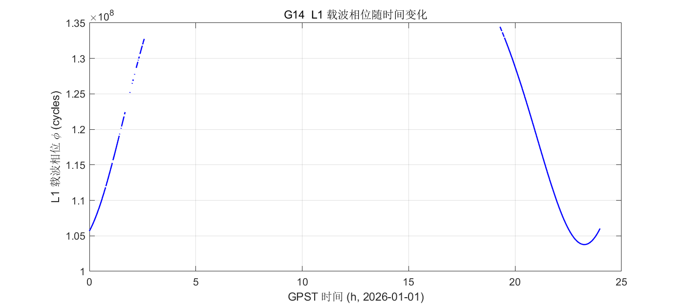
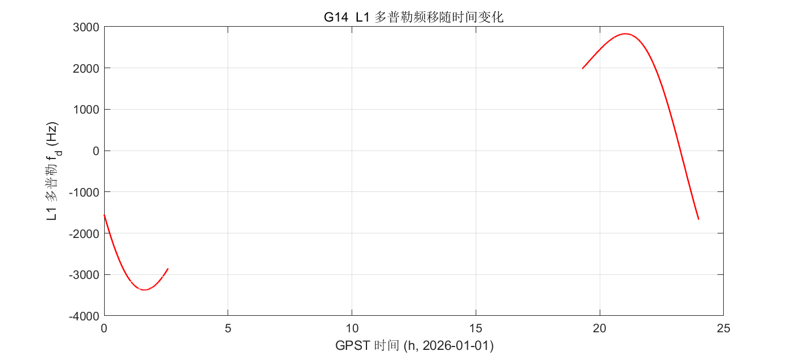
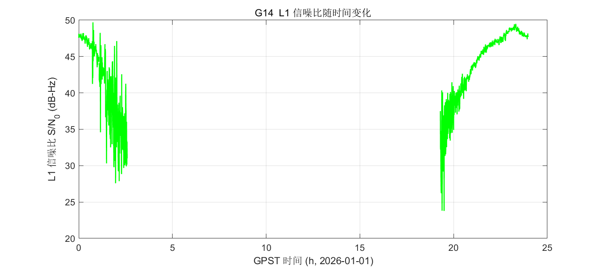
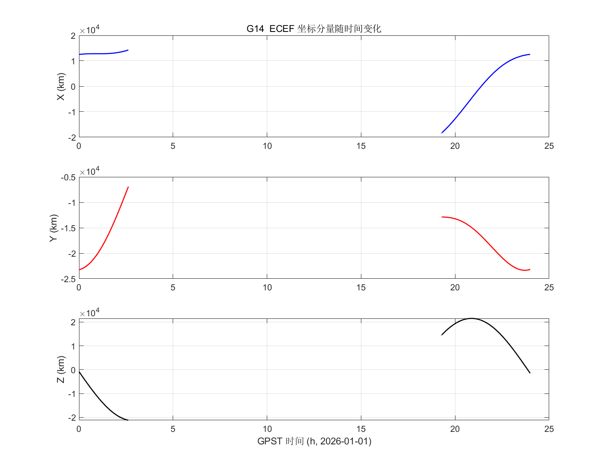
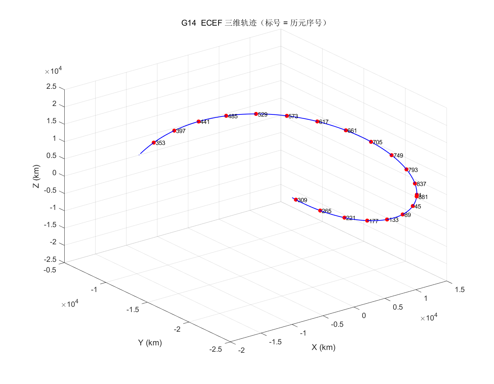

# GNSS 作业：单颗 GPS 卫星 L1 观测与轨道轨迹绘制

> 武汉大学测绘学院 · 测绘程序设计 / GNSS 数据处理 课程作业
> 作者：Ezra230601　|　日期：2026-01-01（数据历元）

---

## 一、题目要求

利用给定的 RINEX 观测文件（O 文件）与广播星历文件（N 文件），对本学号对应的 GPS 卫星完成观测值绘图与轨道位置解算，并输出成果图表与数据表。

### 1. 卫星选取
以**学号末两位**作为 GPS 卫星 PRN 号。

- 本学号末两位为 **14** ⇒ 研究对象为 **GPS PRN 14（G14）**。

### 2. 任务内容

| 任务 | 要求 | 对应输出 |
|---|---|---|
| **任务 1** | 绘制该卫星 **L1 载波相位、L1 多普勒频移、L1 信噪比** 随时间的变化曲线（3 张图） | 图 1 / 图 2 / 图 3 |
| **任务 2** | 解算卫星坐标，绘制 **X、Y、Z 坐标分量**随时间的变化（1 张图） | 图 4 |
| **任务 3** | 绘制卫星 **X-Y-Z 三维轨迹**并标明历元顺序（1 张图） | 图 5 |
| **数据表** | 输出「**时间 + 数据**」表格，含各历元的时间与观测值/坐标 | `homework_table.txt` |

> 要求图表坐标轴须标注物理量与单位。

---

## 二、数据与时间系统

### 数据文件

| 文件 | 说明 |
|---|---|
| `abmf0010(1).26o` | RINEX 3 观测文件。测站 **ABMF**（法属瓜德罗普），2026-01-01，采样间隔 **30 s**，全天 **2880** 个历元 |
| `BRDC00IGS_R_20260010000_01D_MN(1).rnx` | RINEX 3 广播星历（GPS / Galileo / BeiDou） |

> 数据文件体积较大，未纳入本仓库，请自行从 IGS 官网下载后放在 `homework_gnss/` 目录下：
> - 广播星历：<https://cddis.nasa.gov/archive/gnss/products/>
> - 观测文件：<https://cddis.nasa.gov/archive/gnss/data/daily/>

### 时间系统

全程采用 **GPST（GPS 时）**：

- 表中第 1 列为 **GPST 连续秒**（自 1980-01-06 00:00:00 起的秒数）；
- 绘图横轴采用 **GPST 日内秒换算的小时数（h）**；
- 表中第 2 列为对应的 `YYYY-MM-DD HH:MM:SS.sss` 日期时间字符串。

### 观测类型

G14 的 L1 观测值取 RINEX 3 观测行的固定字符位：

| 观测码 | 含义 | 单位 |
|---|---|---|
| `C1C` | L1 C/A 码伪距 | m |
| `L1C` | L1 载波相位 | cycles |
| `D1C` | L1 多普勒 | Hz |
| `S1C` | L1 信噪比（信号强度） | dB-Hz |

---

## 三、实现方法

主脚本为 [`homework.m`](homework.m)，流程如下：

1. **读取广播星历**：调用 `Rinex_get_nav.m` 解析 N 文件，得到 33×N 的星历矩阵 `Eph` 与电离层参数 `iono`。
2. **读取观测文件**：跳过文件头至 `END OF HEADER`，逐历元解析历元首行（`> YYYY MM DD HH MM SS flag nsat`），在历元内定位 `G14` 卫星行，按 14 字符定宽字段提取 `L1C / D1C / S1C`（空字段记为 `NaN`）。
3. **时间转换**：用 `date2gps.m` 将历元时刻转为 GPST 连续秒，并生成日内秒与日期字符串。
4. **卫星坐标解算**（对每个历元）：
   - 用 `find_eph.m` 选取距观测时刻最近的星历；
   - 迭代估算信号发射时刻 `t_tx`，依次作**卫星钟差**（`sat_clock_error_correction.m`）、**相对论效应**（`relativistic_error_correction.m`）与 **TGD** 改正；
   - 由 `satellite_orbits.m` 按 IS-GPS-200 开普勒轨道模型解算卫星 **t_tx 时刻在 ECEF 地固系**下的位置；
   - 作**地球自转（Sagnac）改正**（`earth_rotation_correction.m`），得到信号到达时刻的 ECEF 坐标 `X, Y, Z`。
5. **绘图与输出**：为区分两段可见弧，在时间间隔 > 60 s 处插入 `NaN` 使曲线断开（避免跨"不可见"时段连线造成误导），共输出 5 张 PNG 图与 1 个数据表。

---

## 四、成果文件清单

### 图 1　L1 载波相位随时间变化



### 图 2　L1 多普勒频移随时间变化



### 图 3　L1 信噪比随时间变化



### 图 4　卫星 ECEF 坐标 X / Y / Z 分量随时间变化



### 图 5　卫星 ECEF 三维轨迹（标号 = 历元序号）



### 数据表　`homework_table.txt`

每行对应一个观测历元，共 **882** 行数据（另有 13 行表头注释），列含义：

| 列 | 内容 | 单位 |
|---|---|---|
| 1 | GPST 连续秒 | s |
| 2 | GPST 日期时间 | — |
| 3 | L1 载波相位 | cycles |
| 4 | L1 多普勒 | Hz |
| 5 | L1 信噪比 | dB-Hz |
| 6 | X（ECEF） | m |
| 7 | Y（ECEF） | m |
| 8 | Z（ECEF） | m |

首行数据示例：

```
1451260800.000  2026-01-01 00:00:00.00  105687597.3430  -1546.5770  47.571  12495714.886  -23239343.836  -811133.905
```

---

## 五、运行方法

```matlab
% 在包含数据文件的目录下运行
cd homework_gnss
homework
```

依赖本仓库根目录下的公共函数：`glp_ini.m`、`Rinex_get_nav.m`、`satellite_orbits.m`、`find_eph.m`、
`sat_clock_error_correction.m`、`relativistic_error_correction.m`、`earth_rotation_correction.m`、`date2gps.m`。
请保证这些函数在 MATLAB 搜索路径中（或将 `homework.m` 置于仓库根目录运行）。

运行环境：MATLAB R2020b 及以上，无需额外工具箱。

---

## 六、结果分析与小结

- G14 在 2026-01-01 全天共 **882** 个有效观测历元，分为**两段可见弧**：
  - 第 1 段：**00:00:00 – 02:37:30**，共 315 个历元；
  - 第 2 段：**19:15:30 – 23:59:30**，共 567 个历元；
  - 两段之间（约 16.6 h）卫星位于地平线以下（不可见），图中曲线在该处断开。
- **载波相位**（L1C）在每段可见弧内随历元近似线性增长，符合载波相位随时间连续累积的规律：
  - 第 1 段：1.0569×10⁸ ~ 1.3276×10⁸ cycles；
  - 第 2 段：1.0377×10⁸ ~ 1.3470×10⁸ cycles；
  - 全天有效相位值 808 个，另有 **74 个历元 L1C 缺失**（记为 NaN）。
- **多普勒**（D1C）反映卫星相对测站的视向速度：
  - 第 1 段：−3375.4 ~ −1546.6 Hz；
  - 第 2 段：−1671.5 ~ +2829.0 Hz；
  - 全天有效值 874 个（8 个历元缺失）。
- **信噪比**（S1C）全天有效值 873 个（9 个历元缺失），范围 **23.77 ~ 49.70 dB-Hz**，可见时段信号质量总体良好。
- **轨道坐标**解算结果距地心 **26389 ~ 26721 km**，与 GPS 标称轨道半径（约 26560 km）一致，量级正确。
- 图 5 三维轨迹为一段规则的空间弧线，符合单一可见弧内的轨道几何特征。
